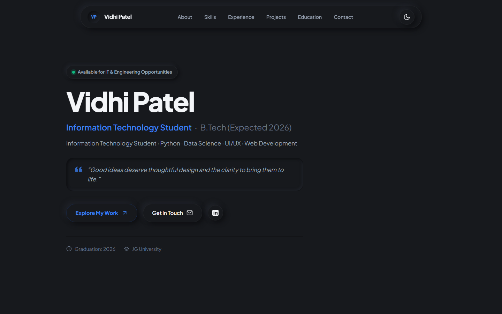

# Vidhi Patel — Personal Portfolio

> **Technologies Used:** HTML5, CSS3, Vanilla JavaScript  
> **Design Philosophy:** Neumorphism (Soft UI) & Minimalism  
> **GitHub Repository:** [patelvidhi5907/Patel_Vidhi_267347_Portfolio](https://github.com/patelvidhi5907/Patel_Vidhi_267347_Portfolio)

---

## 🖼️ Preview



---

## 📌 Overview

This repository contains the source code for the personal portfolio website of **Vidhi Patel**, an Information Technology undergraduate student with practical internship experience in Python programming, Data Science, and Machine Learning, alongside strong interests in web development, UI/UX architecture, and technical documentation.

The portfolio is built from scratch without external frameworks or heavy dependencies, prioritizing clean semantic markup, fast load performance, accessible contrast standards, and an authentic **Neumorphic Minimalist** aesthetic.

---

## 🛠️ Technologies Used

- **HTML5**: Semantic landmarks (`<header>`, `<nav>`, `<main>`, `<section>`, `<article>`, `<footer>`), ARIA accessibility attributes, and SEO/Open Graph metadata.
- **CSS3**: Custom properties (design tokens), CSS Grid & Flexbox, calibrated dual box-shadows for extruded/debossed Neumorphic surfaces, responsive breakpoints, and Light/Dark theme support.
- **Vanilla JavaScript (ES6+)**: Centralized data store (`js/data.js`), Light/Dark theme persistence via `localStorage`, Intersection/scroll-spy navigation, tactile button feedback, 1-click email copy-to-clipboard, and native `mailto:` composer.

---

## 🎨 Design Philosophy: Neumorphism & Minimalism

The visual language marries **Soft UI (Neumorphism)** with **Editorial Minimalism**:

- **Tactile Soft UI Surface Physics**: Elements appear extruded from or debossed into the background canvas using calibrated dual box-shadows (light specular highlight on the upper-left, soft ambient drop shadow on the bottom-right).
- **Physical Feedback on Interaction**: Interactive buttons (`.neu-btn`) smoothly depress into an inset state upon click/tap.
- **Editorial Typography & Hierarchy**: Built with **Plus Jakarta Sans** for body readability and **JetBrains Mono** for technical metadata and section indicators (`[ 01 / OVERVIEW ]`).
- **High-Contrast Accessibility**: Adheres to WCAG AAA contrast ratios with deep charcoal text (`#182232`) on light slate-gray canvas (`#eaedf3`), avoiding the low-contrast pitfalls common in conventional neumorphism.
- **Dual Themes (Light & Dark Neumorphism)**:
  - **Light Mode**: Sculptural cool slate with pure white highlights and soft ambient shading.
  - **Dark Mode**: Matte charcoal-slate (`#17191d`) with refined specular edges (`#20232a`) and deep cast shadows (`#0e0f12`).
  - Automatic synchronization with system preference (`prefers-color-scheme`) and persistence via `localStorage`.

---

## 📂 Project Structure

```
├── index.html          # Semantic HTML5 document with complete accessibility landmarks
├── css/
│   └── style.css       # Neumorphic design tokens, dual shadows, responsive breakpoints
├── js/
│   ├── data.js         # Central source of truth for portfolio data
│   └── main.js         # Theme toggle, scroll spy, tactile feedback, clipboard utility
└── README.md           # Project documentation and architecture overview
```

---

## 🌟 Sections & Architecture

1. **Floating Neumorphic Header & Navbar**:
   - Monogram logo mark (`VP`) with recessed well styling.
   - Smooth navigation with active scroll-spy highlighting.
   - Tactile Light/Dark theme switch with animated SVG icons.
   - Mobile responsive drawer menu with ARIA accessibility.

2. **Hero**:
   - High-impact minimalist typography.
   - Real-time availability indicator pill with glowing pulse animation.
   - Hero quote callout: *“Good ideas deserve thoughtful design and the clarity to bring them to life.”*
   - Direct CTA buttons: `Explore My Work` and `Get in Touch`.

3. **About Me**:
   - Career narrative highlighting Python, Data Science, Machine Learning, Web Development, and UI/UX.
   - 3 Neumorphic highlight cards: Education Status, Internship Exposure, and Focus Areas.

4. **Technical Skills**:
   - Categorized into 4 disciplined areas (no arbitrary percentage meters):
     - **Programming & Web**: Python, Java, JavaScript, HTML, CSS.
     - **CS & Databases**: Data Structures & Algorithms, Database Management, Web Development.
     - **Design & Documentation**: UI/UX Design, Software Requirements Specification (SRS), System Architecture.
     - **Productivity**: MS Office, Content Writing.

5. **Internships & Practical Work**:
   - Vertical timeline with inset guide track and debossed node indicators.
   - **BrainyBeam Info Tech Pvt. Ltd.**: Data Science & Machine Learning Intern (27 May 2025 – 7 Jul 2025).
   - **Hubclash Esports**: Python Programming Intern (27 Jun 2024 – 10 Jul 2024).

6. **Featured Projects**:
   - **Tiffin Mitra**: Full-stack hyperlocal food marketplace and subscription platform built with Next.js 14 App Router, TypeScript, MongoDB, and Tailwind CSS. Features single-cook cart invariants and flexible meal subscriptions with a pause guarantee. Includes direct link to the [GitHub repository](https://github.com/prince312pp/tiffinmitra_prototype).
   - **Sponsorly**: Academic web application case study highlighting UI/UX planning, wireframing, complete SRS document authorship, and technical team alignment.

7. **Education & Certifications**:
   - **Bachelor's Degree in Information Technology**: JG University (Pursuing, Expected 2026).
   - **Diploma in Information Technology**: Sal Institute of Diploma Studies (CGPA: 8.03).
   - **Class X**: Nalanda Vidyalay, Gujarat Board (2023, 63%).
   - **AWS Training & Certification**: Fundamentals of Machine Learning & AI.
   - **Beyond Technology**: Technical Writing, Photography, Content Creation, and Languages (English, Hindi, Gujarati).

8. **Contact & Reach Out**:
   - Direct Email card with **1-click Copy to Clipboard** utility and checkmark feedback.
   - Professional Network link directly to LinkedIn.
   - Direct Message Composer with native `mailto:` link generator.

---

## 🚀 Running Locally

No package manager or build pipeline is needed. You can view the site locally using any standard static server:

### Option 1: Python
```bash
python -m http.server 8000
```
Then open `http://localhost:8000` in your web browser.

### Option 2: Direct File Access
Simply double-click `index.html` to open it in Chrome, Edge, Firefox, or Safari.

---

## 📄 License & Attribution

Designed and developed for **Vidhi Patel**. All portfolio content, design tokens, and source code are maintained for academic and professional presentation.
